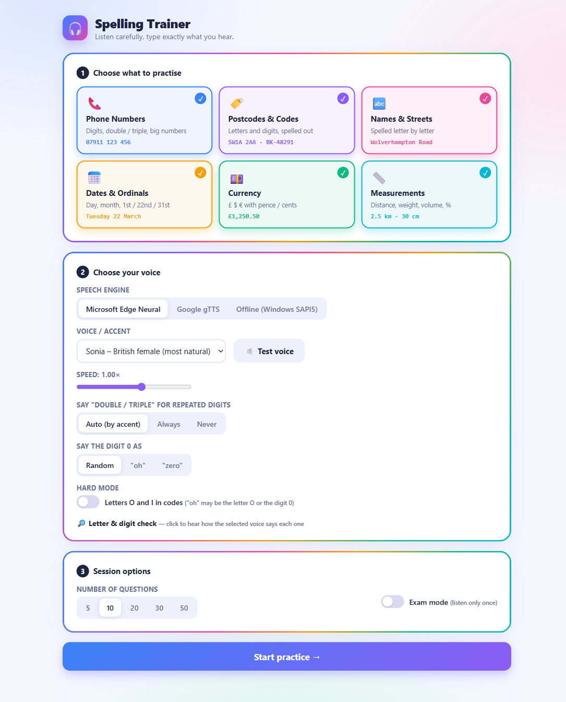
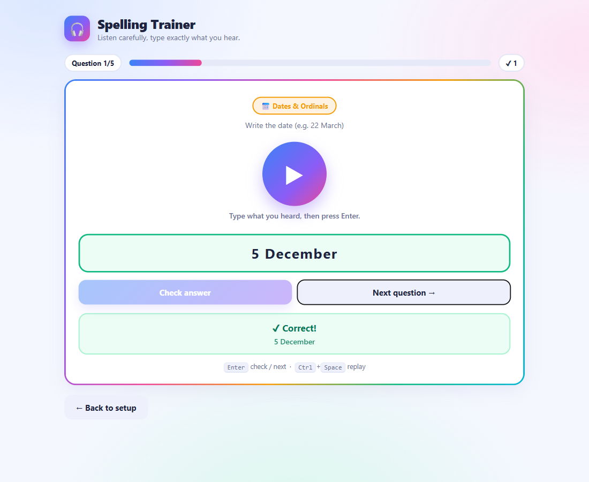
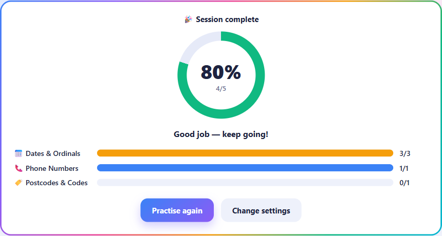

<div align="center">

# 🎧 Spelling Trainer

**Listen. Type. Check. — Practise the tricky parts of spoken English: numbers, spelling, dates and money.**


</div>

---

## ✨ What is it?

A small web app that runs on your own computer. It reads out **randomly generated** phone numbers, postcodes, names, dates, prices and measurements in a natural voice — you type what you hear, and it tells you instantly whether you got it right.

No account, no login, no API key.

## 📸 Screenshots

**1 · Pick what to practise, choose a voice, set up the session**



**2 · Listen, type your answer, get instant feedback**



**3 · See your score and how you did on each type**



## 🎯 Practice types

| | Type | What you hear | Example answer |
|---|---|---|---|
| 📞 | **Phone Numbers** | Digits, *double / triple*, big numbers | `07911 123 456` |
| 🏷️ | **Postcodes & Codes** | Letters and digits, spelled out | `SW1A 2AA` · `BK-48291` |
| 🔤 | **Names & Streets** | Spelled letter by letter | `Wolverhampton Road` |
| 📅 | **Dates & Ordinals** | Weekday, day, month, *21st / 22nd* | `22 March` · `31st` |
| 💷 | **Currency** | £ $ € A$ with pence / cents | `£1,250.50` |
| 📏 | **Measurements** | Distance, weight, volume, % | `2.5 km` · `30 cm` |

Every question is generated fresh and the app avoids repeating any of your last 200 answers.

## 🚀 Quick start

```powershell
# 1. Create the virtual environment and install dependencies (first time only)
python -m venv .venv
.venv\Scripts\python.exe -m pip install -r requirements.txt

# 2. Run
run.bat
```

Or just double-click **`run.bat`**. Your browser opens at **http://spelling.localhost:8765**. Close the terminal window to stop the server.

> `spelling.localhost` works in Chrome, Edge and Firefox. If it does not open, use **http://127.0.0.1:8765** instead — it is the same app.

## 🗣️ Voices

| Engine | Quality | Needs internet | Notes |
|---|---|---|---|
| **Microsoft Edge Neural** (`edge-tts`) | ⭐⭐⭐ Most natural | Yes | Recommended. British, Australian and American voices |
| **Google gTTS** | ⭐⭐ Good | Yes | British, American, Australian accents |
| **Offline (Windows SAPI5)** | ⭐ Robotic | No | Works without a connection |

**Edge voices:** Sonia 🇬🇧 · Ryan 🇬🇧 · Libby 🇬🇧 · Natasha 🇦🇺 · William 🇦🇺 · Ava 🇺🇸 · Emma 🇺🇸 · Andrew 🇺🇸 · Brian 🇺🇸

Use **🔈 Test voice** in the setup screen to hear a sample before you start.

## ⚙️ Settings

- **Speed** — 0.6× to 1.3× (default 1.00×).
- **Double / triple** — *Auto* (UK/AU say "double seven", US says "seven seven"), *Always* or *Never*.
- **Say the digit 0 as** — *Random*, *"oh"* or *"zero"*.
- **Hard mode** — adds the letters **O** and **I** to codes, so "oh" could be the letter O *or* the digit 0.
- **Exam mode** — you can listen **only once**, like the real test.
- **Letter & digit check** — click any letter or digit to hear how the selected voice says it (e.g. Z is *zed* for UK/AU, *zee* for US).

Your choices are remembered in the browser (separately for each address, so settings saved at `127.0.0.1` will not appear at `spelling.localhost`).

## ⌨️ Shortcuts

| Key | Action |
|---|---|
| `Enter` | Check the answer, then go to the next question |
| `Ctrl` + `Space` | Replay the audio |

## ✅ How answers are checked

- **Phone numbers, codes, names** — case, spaces, hyphens and commas are ignored.
- **Dates** — `22 March`, `22/03`, `March 22nd` all work. The weekday is optional.
- **Ordinals** — `21` or `21st`.
- **Currency** — you must include the symbol: `£45.50`. Commas are optional.
- **Measurements** — number plus unit; `km` and `kilometres` are both accepted.

## 📁 Project structure

```
spelling-trainer/
├── server.py          # Local web server and API
├── generators.py      # Random question generators for the 6 types
├── checker.py         # Answer checking
├── tts_engines.py     # Edge / gTTS / offline text-to-speech
├── web/
│   └── index.html     # The web interface
├── images/            # Screenshots used in this README
├── requirements.txt
└── run.bat            # Double-click to start
```

## 🔌 API (for tinkering)

| Endpoint | Purpose |
|---|---|
| `GET /api/engines` | List speech engines and whether they are installed |
| `GET /api/voices?engine=edge` | List voices for an engine |
| `GET /api/categories` | List the 6 practice types |
| `POST /api/question` | Generate a new random question. Body: `cats`, `engine`, `voice`, `double`, `zero`, `hard` |
| `POST /api/tts` | Generate speech for a question (`id`), a sample (`text`) or a single letter (`spell`) |
| `POST /api/check` | Check an answer. Body: `id`, `answer` |

## 📝 Notes

- Edge and gTTS voices need an internet connection; the offline engine does not.
- The first question of a session can take a second or two while the voice is generated.
- Port **8765** and the address `spelling.localhost` are set in `server.py` (`PORT` and `url`).
- The app only listens on your own computer (`127.0.0.1`); it is not reachable from other devices.

## 🛠️ Troubleshooting

| Problem | Fix |
|---|---|
| Page does not open at `spelling.localhost` | Use `http://127.0.0.1:8765` |
| "Address already in use" | Another program uses port 8765 — close it or change `PORT` in `server.py` |
| "Could not generate speech" | Check your internet connection, or switch to the **Offline** engine |
| Engine shows "(not installed)" | Run `.venv\Scripts\python.exe -m pip install -r requirements.txt` |
| No sound | Click the big ▶ button once — browsers block autoplay until you interact with the page |

## 🤝 Contributing

Found a bug or have an idea? Open an [issue](../../issues/new/choose). See [CONTRIBUTING.md](CONTRIBUTING.md) for how to send a change.

## 📄 License

Released under the [Apache License 2.0](LICENSE).

---

<div align="center">

Happy practising! 🍀

</div>
